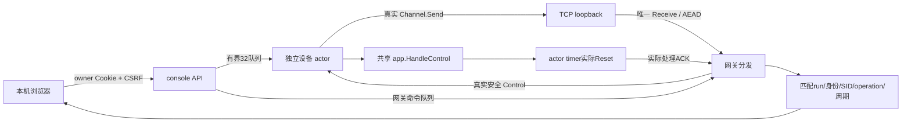

# 架构与来源迁移

新增入口 cmd/console，仅处理参数、Windows单实例、启动、停止。internal/live 实现持续双向业务；internal/console负责页面、owner会话和受控API。原cmd/demo、gateway/device有限模式、bench/pbench保留。

单机统一事件来自两个真实端点及API观察端，来源分别标记。遥测“确认”是本机网关验收观测，不虚构额外线上的遥测ACK。控制确认则必须收到验证通过的真实Ack记录。

|原函数/模块|交互版本用途|影响|
|---|---|---|
|handshake.Client/Server|原四消息握手|H1–H4、KDF和套件字节不变|
|secureChannel.Send|原序号、Seal、完整写入串行|不变|
|secureChannel.Receive|唯一分发者；显式本地IdleTimeout|零值保持原超时；首字节后严格短预算|
|app.HandleControl|唯一校验/幂等/ACK业务服务|新增可选timer事务和有界账本；legacy constructor保持旧行为|
|app.ValidateTelemetry|网关身份/温度校验|拒绝NaN/Inf，合法旧输入不变|
|identity.Registry|持久可信身份|管理通过原CAS，不HTTP拼Shell|
|internal.demo|旧只读有限Demo|源码/旧exe保留，独立模式|
|internal.bench / pbench|原正式测量/有限smoke|旧raw/hash冻结，新source/run另建|

边界：同进程本机模拟网关和设备仍各自独立真实Channel与TCP端点、独立身份和世代；API不向网关收件箱插数据。软件不是跨机硬件部署验证，也没有合规或后量子身份认证证明。SM2签名仍传统。

## interactive-v1.2 模块增量

management/gateway.go独立公共计划、准备文件验证、快照CAS和清理；live/gateway_lifecycle.go负责串行维护、准入门控、所有TCP/旧队列停止等待、commit之后实际Runtime加载和失败安全。dispatch/watch/device记录并核验网关实际世代，不改变密码握手和记录实现。identity.FileStore.Retire对非不存在的读取错误报告失败，避免清理误报；未引入认证跳过。

console仍嵌入本地无依赖模块：intro五步主流程、workbench稳定表单及相邻回执、usability纯呈现/精确单位/分页规则；app协调轮询、导航和授权状态，keys独立全设备影响确认，logs固定事件cursor有界筛选。高级与简洁调用相同API和同一run。所有按钮动作显式触发，刷新仅GET，无后台重试。

新增API只调用受控Go服务，不拼Shell、不绕CAS写trust。退出通过Manager取消上下文，cmd/console既有停止钩子关闭HTTP/TCP及实验进程。导出按Snapshot副本过滤，保存选择范围和来源sha；不引入数据库或新密码组件。
